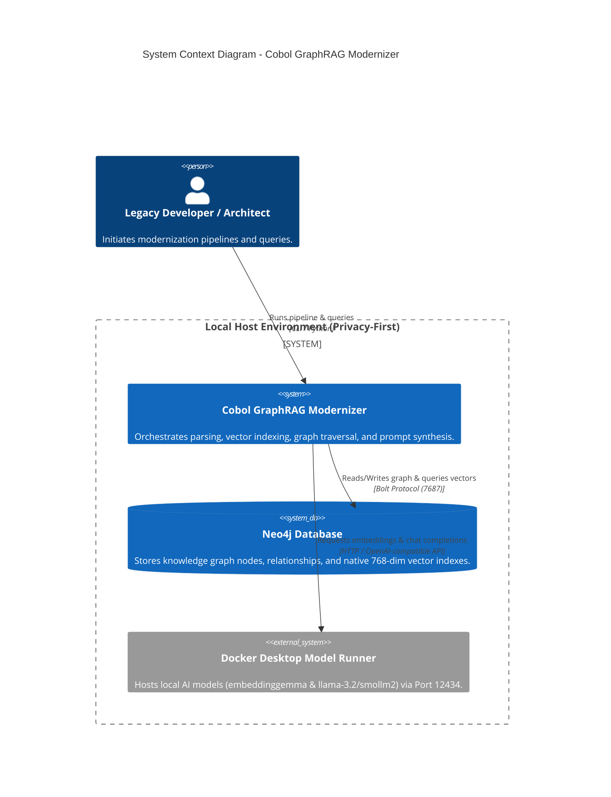
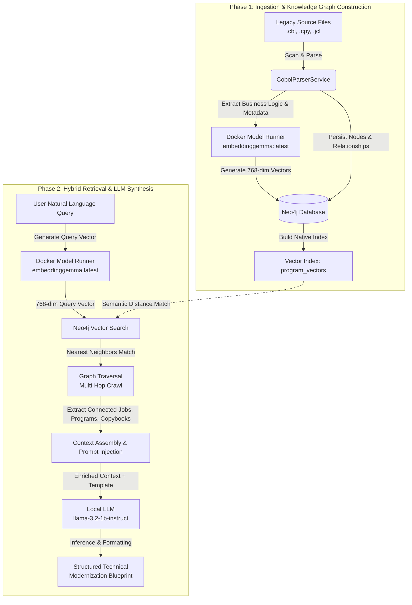
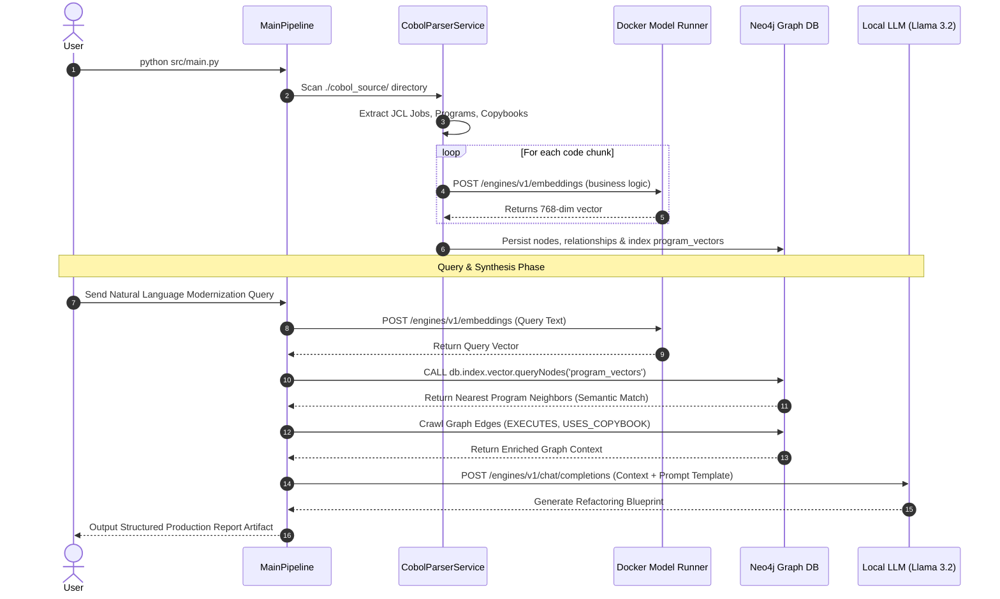
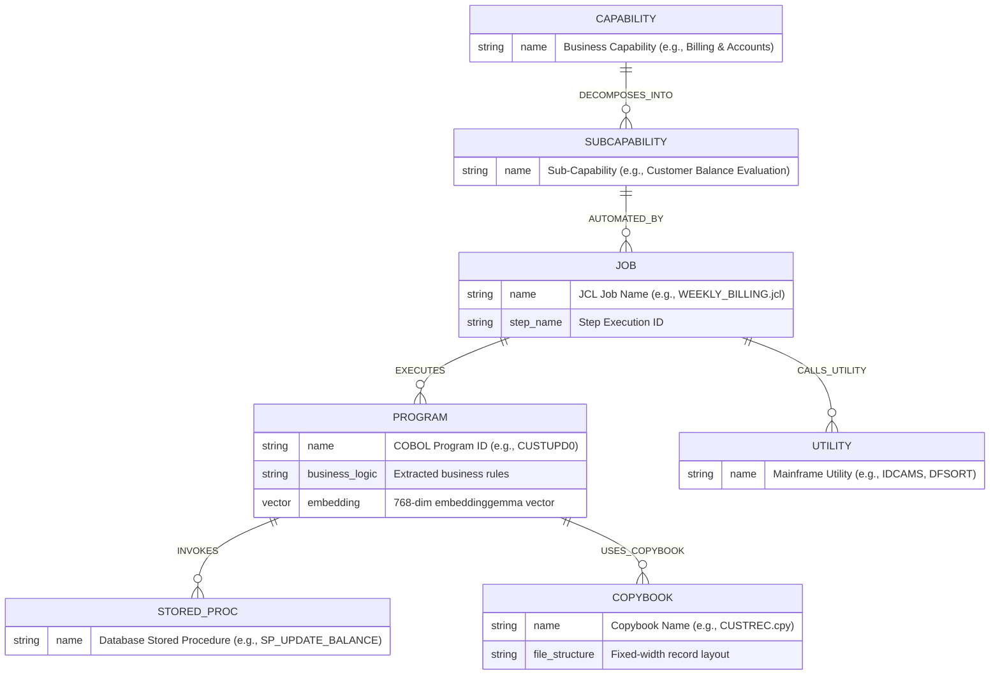

# Cobol GraphRAG Modernizer

An enterprise-grade tool designed to automate the reverse-engineering of mainframe COBOL, JCL, and copybook assets into a **Neo4j Knowledge Graph** equipped with **Native Vector Indexing**. It bridges exact dependency tracing with semantic search to generate comprehensive business analysis and modernization reports via local or cloud LLMs.

Supports **both** local privacy-first execution (via Docker Desktop's built-in Model Runner) and cloud execution (OpenAI).

---

## 🏗️ Architecture & Core Components

1. **Parser Service:** Safely reads legacy files and extracts dependency relationships (`EXECUTES`, `USES_COPYBOOK`).
2. **Neo4j Storage:** Persists nodes and relationships while computing vector embeddings over business logic.
3. **Hybrid Search:** Combines semantic vector similarity search with index-free graph traversal.
4. **LLM Synthesis:** Feeds enriched multi-hop context into local or cloud models to produce actionable modernization documentation.

---

## 🔄 Life of a Request

The pipeline operates in two distinct phases: **Ingestion & Indexing** (building the intelligence layer) and **Hybrid Retrieval & Synthesis** (executing user queries).


```

[Legacy Source Files (.cbl, .cpy, .jcl)]
│
▼  (Phase 1: Ingestion & Vectorization)
[CobolParserService] ──► Extracts Graph Nodes & Business Logic
│
├─────────────────────────────────┐
▼                                 ▼
[Docker Model Runner]             [Neo4j Database]
(embeddinggemma)             Persists Nodes & Relationships
│                                 │
└────────► [Native Vector Index (`program_vectors`)] ◄──┘

```

### Phase 1: Ingestion & Knowledge Graph Construction
1. **Parsing:** The `CobolParserService` scans local directories (`./cobol_source/`) to parse JCL jobs, COBOL programs, and shared copybooks.
2. **Embedding Generation:** Business logic text blocks are sent to the local embedding model (`ai/embeddinggemma:latest`) hosted via Docker Desktop Model Runner (`http://localhost:12434/engines/v1`) to generate 768-dimensional vector embeddings.
3. **Neo4j Persistence:** Nodes (`:Job`, `:Program`, `:Copybook`) and their interdependencies (`EXECUTES`, `USES_COPYBOOK`) are saved to Neo4j, alongside a native vector index (`program_vectors`) configured for 768 dimensions.

---


```

[User Natural Language Query]
│
▼  (Phase 2: Hybrid Retrieval & LLM Synthesis)
[Docker Model Runner Embeddings] ──► Generates Query Vector (768-dim)
│
▼
[Neo4j Vector Search] ──► Retrieves Nearest Neighbors (Semantic Match)
│
▼
[Graph Traversal] ──► Crawls Connected Edges (JCL Jobs & Copybooks)
│
▼
[Context Assembly & Prompt Injection]
│
▼
[Local LLM (Llama 3.2 1B / SmolLM2)] ──► Inference on Docker Model Runner
│
▼
[Structured Modernization Blueprint Delivered to User]

```

### Phase 2: Querying, Retrieval, and Inference
1. **Semantic Querying:** When a user inputs a prompt query, it is converted into a 768-dimensional vector using the local embedding model, bypassing fragile keyword or lexical matching.
2. **Vector Similarity Matching:** Neo4j evaluates vector distances (`vector.similarity_function: 'cosine'`) to instantly return the nearest neighbor program chunks.
3. **Graph Traversal (Multi-Hop Crawl):** The system crawls outward from the matched program nodes through the Neo4j knowledge graph to capture connected dependencies (such as upstream JCL jobs and downstream copybook data structures).
4. **Context Clubbing & Prompt Injection:** The extracted code snippets, business logic descriptions, and graph relationships are merged into a precision-engineered prompt template.
5. **Local LLM Inference:** The enriched context is sent to the local instruction model (e.g., `hf.co/bartowski/llama-3.2-1b-instruct-gguf`) running inside Docker Desktop Model Runner.
6. **Artifact Generation:** The model synthesizes the findings into a structured, developer-ready Technical Modernization & Refactoring Blueprint returned directly to the user.

---

## 📋 Prerequisites

* **Python 3.10+**
* **Docker Desktop** (with Model Runner enabled for local models, or a running Neo4j instance)

---

## ⚙️ Configuration (`.env`)

In the root of your cloned repository, create a `.env` file based on your preferred execution provider.

### Option A: Local Docker Desktop Models (Default)
Docker Desktop's Model Runner exposes an OpenAI-compatible endpoint on port `12434` under `/engines/v1`.

```env
# --- Provider Switch ---
LLM_PROVIDER=docker

# --- Docker Desktop / Local Models Configuration ---
LOCAL_AI_BASE_URL=http://localhost:12434/engines/v1
LOCAL_AI_API_KEY=not-needed
LOCAL_CHAT_MODEL=hf.co/bartowski/llama-3.2-1b-instruct-gguf
LOCAL_EMBEDDING_MODEL=ai/embeddinggemma:latest

# --- Neo4j Database Configuration ---
NEO4J_URI=bolt://127.0.0.1:7687
NEO4J_USER=neo4j
NEO4J_PASSWORD=password

```

### Option B: OpenAI Cloud Models

```env
# --- Provider Switch ---
LLM_PROVIDER=openai

# --- OpenAI Configuration ---
OPENAI_API_KEY=your-actual-api-key-here
OPENAI_CHAT_MODEL=gpt-4o
OPENAI_EMBEDDING_MODEL=text-embedding-3-small

# --- Neo4j Database Configuration ---
NEO4J_URI=bolt://127.0.0.1:7687
NEO4J_USER=neo4j
NEO4J_PASSWORD=password

```

---

## 🚀 Quick Start Guide

### Step 1: Start Neo4j via Docker

Spin up a local Neo4j instance using Docker:

```bash
docker run \
  --name neo4j-graphrag \
  -p 7687:7687 -p 7474:7474 \
  -e NEO4J_AUTH=neo4j/password \
  neo4j:latest

```

*(Verify Neo4j is running by opening `http://localhost:7474` in your browser).*

### Step 2: Install Dependencies

Create a virtual environment, activate it, and install required packages:

```bash
python -m venv venv
# On Windows (PowerShell):
.\venv\Scripts\Activate
# On macOS/Linux:
# source venv/bin/activate

pip install -r requirements.txt

```

### Step 3: Generate Mock COBOL Workspace

Populate sample JCL jobs, programs (`CUSTUPD0`, `INTRCALC`), and copybooks under `./cobol_source/`:

```bash
python script/setup_workspace.py

```

### Step 4: Run the Pipeline

Execute the main pipeline to parse assets, generate embeddings, build the Neo4j graph with native vector indexing, and output the modernization report:

```bash
python src/main.py

```

---

## 🔍 Visualizing the Graph in Neo4j Browser

1. Navigate to **`http://localhost:7474`** in your browser.
2. Log in with your credentials (`neo4j` / `password`).
3. Run the following Cypher query to explore your full legacy dependency graph:
```cypher
MATCH (n)
OPTIONAL MATCH (n)-[r]->(m)
RETURN n, r, m;

```


---

## 🛠️ Utility Maintenance Scripts

* **Clean Database & Indexes:** If you switch embedding models (e.g., changing vector dimensions between `768` and `1536`), run the cleanup utility before re-running the pipeline:
```bash
python scripts/clean_graph.py

```


* **Test Semantic Search:** Validate your local vector store and embeddings index independently:
```bash
python src/test_search.py

```


### 1. System Context Diagram

Shows how the components interact locally without cloud or external dependencies.



---

### 2. End-to-End Pipeline Flow Diagram (Life of a Request)

Covers both Phase 1 (Ingestion & Vectorization) and Phase 2 (Hybrid Retrieval & Synthesis).



---

### 3. Sequence Diagram (Request & Inference Execution)

Illustrates the chronological interaction between the pipeline services, Docker Model Runner, and Neo4j.



---

### 4. COBOL Knowledge Graph Relationship Model

Represents how business capabilities, technical components, jobs, programs, utilities, stored procedures, and copybooks are modeled as nodes and edges in Neo4j.




# Capability Discovery
We want to bridge the gap between high-level business domains (Business Capabilities) and low-level mainframe technical assets (Jobs, Programs, Copybooks, Utilities, Stored Procedures) by leveraging semantic search and knowledge graph traversal.

### Rephrased & Enhanced Feature Specification: **Semantic Capability Discovery & Graph Tagging**

* **Objective:** Automatically map high-level enterprise business capabilities (provided via a title and a 4-5 sentence functional summary) down to their exact technical implementation layers within the Neo4j Knowledge Graph.
* **Input Parameters:**
    1. `capability_name`: The high-level business domain name (e.g., *"Customer Financial Ledger Management"*).
    2. `capability_summary`: A 4-5 sentence rich narrative describing the business intent, triggers, data processing rules, and expected outcomes.


* **Workflow Stages:**
    1. **Vectorization:** The capability summary is transformed into a 768-dimensional vector embedding using the local embedding model (`ai/embeddinggemma:latest`).
    2. **Semantic Seeding & Similarity Matching:** The system queries the Neo4j vector index (`program_vectors`) to identify the closest matching core COBOL programs and business logic chunks.
    3. **Multi-Hop Graph Expansion:** The graph engine crawls outward from the matched programs to automatically discover linked upstream JCL jobs, downstream copybooks, databases, and utility modules.
    4. **Dynamic Ontology Enrichment (Tagging):** The system injects new `:Capability` and `:SubCapability` nodes into Neo4j and establishes explicit relationships (`IMPLEMENTS`, `DECOMPOSES_INTO`, `EXECUTES`, `USES_COPYBOOK`) to visually group the technical assets under the business domain.

## Business Capability Modernization Report
To seamlessly tie this new **Capability Discovery** feature into your existing local pipeline, we can extend your architecture to automatically generate a **Business Capability Modernization Report** using the newly tagged graph context.

Here is how we can integrate capability-driven reporting into your workflow.

### Step 1: Add Capability-Driven Report Generation 
Create a script that takes a discovered capability, pulls its entire multi-hop neighborhood from Neo4j (Jobs, Programs, Copybooks, Sub-capabilities), and passes that enriched context to your local Docker LLM (`llama-3.2-1b-instruct-gguf`) for enterprise synthesis.


### Step 2: Run the End-to-End Discovery & Reporting Pipeline

1. Run your capability mapping script:
```bash
python src/capability_discovery.py

```


2. Generate the deep-dive LLM architectural report based on the discovered graph relationships:
```bash
python src/capability_report.py

```

