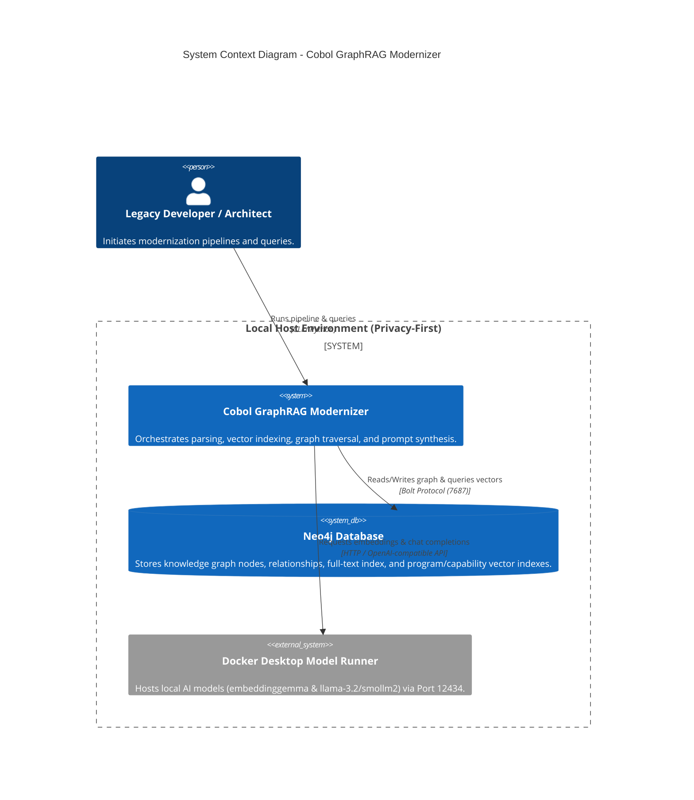
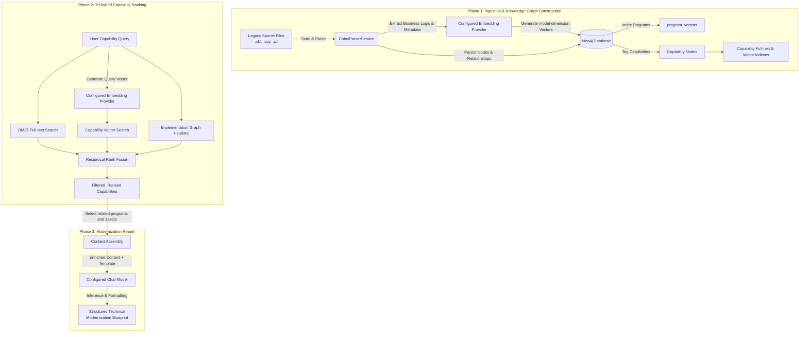
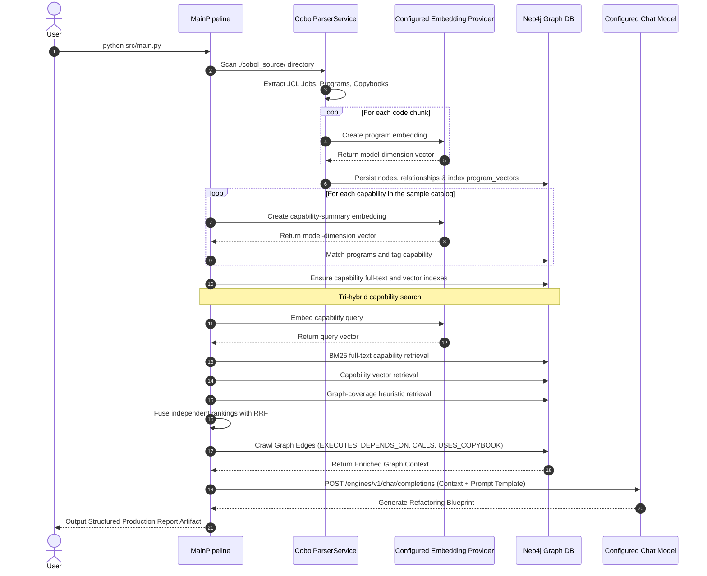
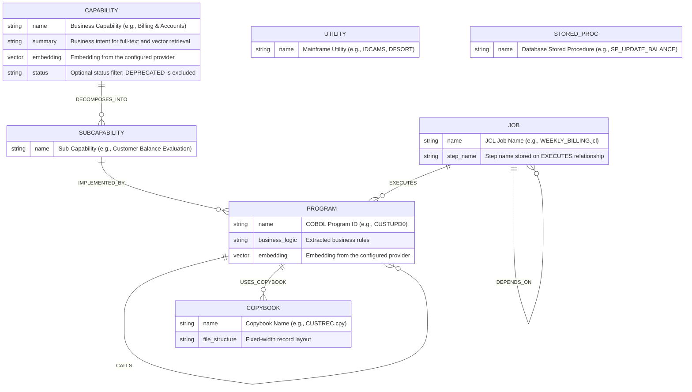

# Cobol GraphRAG Modernizer

An enterprise-grade tool designed to automate the reverse-engineering of mainframe COBOL, JCL, and copybook assets into a **Neo4j Knowledge Graph** equipped with **Native Vector Indexing**. It bridges exact dependency tracing with semantic search to generate comprehensive business analysis and modernization reports via local or cloud LLMs.

Supports **both** local privacy-first execution (via Docker Desktop's built-in Model Runner) and cloud execution (OpenAI).

---

## 🏗️ Architecture & Core Components

1. **Parser Service:** Recursively reads JCL, COBOL source (including files under `utils/`), and copybooks. It extracts ordered JCL execution (`EXECUTES`), scheduler dependencies (`DEPENDS_ON`), static COBOL calls (`CALLS`), and copybook usage (`USES_COPYBOOK`).
2. **Neo4j Storage:** Persists technical assets, capability summaries, and their relationships.
3. **Tri-hybrid Capability Discovery:** Combines BM25 full-text retrieval, capability-summary vector search, and implementation-graph heuristics with reciprocal rank fusion (RRF).
4. **Hybrid Search & LLM Synthesis:** Retrieves graph context for modernization reports using local or cloud models.

---

## 🔄 Life of a Request

The pipeline builds a searchable graph, then combines lexical, semantic, and structural signals to rank capabilities before generating a modernization report.


```

[Legacy Source Files (.cbl, .cpy, .jcl)]
        │
        ▼
(Phase 1: Ingestion & Vectorization)
[CobolParserService] ──► Extracts Graph Nodes & Business Logic
        │
        ├─────────────────────────────────┐
        ▼                                 ▼
[Configured Embedding Provider]    [Neo4j Database]
                                   Persists Nodes & Relationships
        │                                  │
        └────────► [Program & Capability Vector Indexes] ◄──────┘

```

### Tri-hybrid capability ranking

```text
[Capability query]
     ├──► BM25 full-text index ─────┐
     ├──► Capability vector index ──┼──► Reciprocal Rank Fusion
     └──► Implementation graph ─────┘          │
                                               ▼
                         Ranked capabilities with evidence details
```

The lexical and semantic channels independently retrieve capability nodes by
name and summary. The graph heuristic ranks capabilities with implementing
programs, their executing jobs, and used copybooks. RRF combines ranks rather
than comparing BM25 and cosine scores on different scales. Capabilities
explicitly marked `DEPRECATED` are excluded; a missing status is treated as
active.

### Phase 1: Ingestion & Knowledge Graph Construction
1. **Parsing:** The `CobolParserService` scans `./cobol_source/` recursively. JCL becomes `:Job` nodes, `.cbl` files (including shared utilities) become `:Program` nodes, and `.cpy` files become `:Copybook` nodes. Stored-procedure `.sql` files are included in the generated sample workspace but are not currently parsed or ingested.
2. **Embedding Generation:** Program and capability summaries are embedded using the configured provider. Vector index dimensions follow the generated embeddings.
3. **Neo4j Persistence:** Nodes (`:Job`, `:Program`, `:Copybook`) and their interdependencies (`EXECUTES`, `DEPENDS_ON`, `CALLS`, `USES_COPYBOOK`) are saved to Neo4j. `EXECUTES` relationships retain JCL step names and order. Capability nodes store their summary and embedding for tri-hybrid discovery.
4. **Search Indexes:** `program_vectors` indexes program embeddings, `capability_vectors` indexes capability summaries, and `capability_text_index` indexes capability names and summaries for BM25 retrieval.

---


```

[User Natural Language Query]
                │
                ▼
     (Phase 2: Hybrid Retrieval & LLM Synthesis)
[Configured Embedding Provider] ──► Generates Query Vector
                │
                ▼
[Neo4j Vector Search] ──► Retrieves Nearest Neighbors (Semantic Match)
                │
                ▼
[Graph Traversal] ──► Crawls Connected Edges (JCL Jobs & Copybooks)
                │
                ▼
[Context Assembly & Prompt Injection]
                │
                ▼
[Local LLM (Llama 3.2 1B / SmolLM2)] ──► Inference on Docker Model Runner
                │
                ▼
[Structured Modernization Blueprint Delivered to User]

```

### Phase 2: Querying, Retrieval, and Inference
1. **Lexical Retrieval:** BM25 full-text search finds capabilities whose names or summaries contain query terms and identifiers.
2. **Semantic Retrieval:** The query is embedded and compared against capability-summary vectors with cosine similarity.
3. **Graph Heuristic:** Implemented program, executing-job, and copybook counts rank structurally supported capabilities; capabilities without implementing programs and explicitly deprecated capabilities are filtered out.
4. **Rank Fusion:** Reciprocal Rank Fusion combines the three independently ranked lists, avoiding direct arithmetic between raw scores on different scales.
5. **Context Retrieval & Synthesis:** The existing modernization search retrieves matching program code, business logic, jobs, and copybooks, then sends that context to the configured chat model for a report.

---

## 📋 Prerequisites

* **Python 3.10+**
* **Neo4j 5.15+** (full-text and vector indexes enabled)
* **Docker Desktop** (with Model Runner enabled for local models, or a running Neo4j instance)

---

## ⚙️ Configuration (`.env`)

In the root of your cloned repository, create a `.env` file based on your preferred execution provider.

### Option A: Local Docker Desktop Models (Default)
Docker Desktop's Model Runner exposes an OpenAI-compatible endpoint on port `12434` under `/engines/v1`.

```env
# --- Provider Switch ---
LLM_PROVIDER=docker

# --- Docker Desktop / Local Models Configuration ---
LOCAL_AI_BASE_URL=http://localhost:12434/engines/v1
LOCAL_AI_API_KEY=not-needed
LOCAL_CHAT_MODEL=hf.co/bartowski/llama-3.2-1b-instruct-gguf
LOCAL_EMBEDDING_MODEL=ai/embeddinggemma:latest

# --- Neo4j Database Configuration ---
NEO4J_URI=bolt://127.0.0.1:7687
NEO4J_USER=neo4j
NEO4J_PASSWORD=password

```

### Option B: OpenAI Cloud Models

```env
# --- Provider Switch ---
LLM_PROVIDER=openai

# --- OpenAI Configuration ---
OPENAI_API_KEY=your-actual-api-key-here
OPENAI_CHAT_MODEL=gpt-4o
OPENAI_EMBEDDING_MODEL=text-embedding-3-small

# --- Neo4j Database Configuration ---
NEO4J_URI=bolt://127.0.0.1:7687
NEO4J_USER=neo4j
NEO4J_PASSWORD=password

```

---

## 🚀 Quick Start Guide

### Step 1: Start Neo4j via Docker

Spin up a local Neo4j instance using Docker:

```bash
docker run \
  --name neo4j-graphrag \
  -p 7687:7687 -p 7474:7474 \
  -e NEO4J_AUTH=neo4j/password \
  neo4j:latest

```

*(Verify Neo4j is running by opening `http://localhost:7474` in your browser).*

### Step 2: Install Dependencies

Create a virtual environment, activate it, and install required packages:

```bash
python -m venv venv
# On Windows (PowerShell):
.\venv\Scripts\Activate
# On macOS/Linux:
# source venv/bin/activate

pip install -r requirements.txt

```

### Step 3: Generate Mock COBOL Workspace
Populate 11 sample JCL jobs, 19 COBOL programs (including shared utilities), 12 copybooks, and 9 DB2 stored-procedure SQL files for eight business capabilities (customer accounts, payments, loans, cards, claims, regulatory reporting, customer onboarding, and treasury cash management) under `./cobol_source/`. The seed also reuses audit, date, amount, and record-layout assets across flows. JCL `//* DEPENDS-ON:` comments model scheduler-level job ordering; the parser records those dependencies and the ordered program steps in the graph:

```bash
python scripts/setup_workspace.py

```

The shared `COMMON_PRECHECK` and `COMMON_RECONCILIATION` jobs are referenced by multiple capability jobs. COBOL programs call common `DATEUTIL`, `AMOUNTUT`, and `AUDITLOG` utility programs, and share copybooks such as `CUSTREC` and `AUDITREC`. The `MONTH_END` job depends on `WEEKLY_BILLING`, while `REGULATORY_REPORTING` depends on payment, card-settlement, and reconciliation jobs.

The seed writes `//* DEPENDS-ON: JOB_NAME` lines as illustrative scheduler metadata. These comments are not native JCL control statements; they are a convention recognized by this project's parser. JCL `EXEC` steps are captured in source order as `EXECUTES` relationships with `step_name` and `step_order` properties. Utilities stored as `.cbl` files are represented as programs, while SQL stored procedures remain files only.

### Step 4: Run the Pipeline

Execute the main pipeline to parse assets, generate embeddings, seed the eight sample capabilities, run tri-hybrid ranking, and generate a modernization report:

```bash
python src/main.py

```

### Step 5: Discover Business Capabilities in the Notebook

Open [`notebooks/capability_discovery.ipynb`](./notebooks/capability_discovery.ipynb) from the repository root, select the project Python environment, and run the imports/setup cell. Run ingestion first so that the program embeddings and `program_vectors` index exist. Run each capability input cell followed by its `discover_and_tag` cell to populate the capability catalog, then run the tri-hybrid query cell to rank existing capabilities. The notebook examples cover:

- Customer Financial Balance Management
- Customer Payments and Transfers
- Loan Servicing and Interest Accrual
- Card Authorization and Settlement
- Insurance Claims Adjudication
- Regulatory Reporting and AML Compliance
- Customer Onboarding and KYC Verification
- Treasury Cash Position and Forecasting

Each discovery example uses `top_k=2`; adjust this argument in its discovery cell to return more or fewer program matches.

For an interactive terminal workflow that seeds the catalog and asks for a search query, run:

```bash
python scripts/discover_capabilities.py
```

The CLI also exposes this workflow as **Tri-hybrid Capability Discovery**. `top_k`, `candidate_k`, and the RRF constant (`rrf_k`, default `60`) can be adjusted when calling `discover_capabilities`.

### Run the unit tests

The tri-hybrid ranking and query orchestration tests use mocked embedding and Neo4j clients:

```bash
python -m unittest discover -s tests -v
```

---

## 🔍 Visualizing the Graph in Neo4j Browser

1. Navigate to **`http://localhost:7474`** in your browser.
2. Log in with your credentials (`neo4j` / `password`).
3. Run the following Cypher query to explore your full legacy dependency graph:
```cypher
MATCH (n)
OPTIONAL MATCH (n)-[r]->(m)
RETURN n, r, m;

```

To inspect scheduler dependencies and ordered JCL steps specifically:

```cypher
MATCH (job:Job)-[r:DEPENDS_ON|EXECUTES]->(target)
RETURN job.name AS job, type(r) AS relationship,
       r.step_order AS step_order, r.step_name AS step_name,
       target.name AS target
ORDER BY job, r.step_order;
```


---

## 🛠️ Utility Maintenance Scripts

* **Clean Database & Indexes:** If you switch embedding models (e.g., changing vector dimensions between `768` and `1536`), run the cleanup utility before re-running the pipeline:
```bash
python scripts/clean_graph.py

```


* **Test Semantic Search:** Validate your local vector store and embeddings index independently:
```bash
python src/test_search.py

```


### 1. System Context Diagram

Shows how the components interact locally without cloud or external dependencies.



---

### 2. End-to-End Pipeline Flow Diagram



---

### 3. Sequence Diagram (Request & Inference Execution)

Illustrates ingestion, capability catalog seeding, tri-hybrid ranking, and report generation.



---

### 4. COBOL Knowledge Graph Relationship Model

The diagram below is a conceptual target model. The current parser and graph repository ingest `Job`, `Program`, and `Copybook` nodes and the relationships listed in the implementation notes below. In particular, `.cbl` utility modules are `Program` nodes and SQL stored-procedure files are not currently ingested as graph nodes.



For the currently ingested relationships, `DEPENDS_ON` points from a dependent job to its prerequisite job; `EXECUTES.step_order` and `EXECUTES.step_name` identify each program's position and step label in the JCL source. `CALLS` captures statically named COBOL `CALL 'PROGRAM-ID'` statements.


# Capability Discovery
We want to bridge the gap between high-level business domains (Business Capabilities) and low-level mainframe technical assets (Jobs, Programs, Copybooks, Utilities, Stored Procedures) by leveraging semantic search and knowledge graph traversal.

### Rephrased & Enhanced Feature Specification: **Semantic Capability Discovery & Graph Tagging**

* **Objective:** Map a high-level capability name and functional summary to semantically similar COBOL programs, then show their linked JCL jobs and copybooks.
* **Input Parameters:**
    1. `capability_name`: The high-level business domain name (e.g., *"Customer Financial Ledger Management"*).
    2. `capability_summary`: A 4-5 sentence rich narrative describing the business intent, triggers, data processing rules, and expected outcomes.


* **Workflow Stages:**
    1. **Capability Seeding:** `discover_and_tag` embeds each capability summary, retrieves similar COBOL programs from `program_vectors`, and stores a `:Capability` node with its summary and embedding.
    2. **Lexical Retrieval:** `capability_text_index` ranks capability names and summaries using Neo4j full-text search (BM25).
    3. **Semantic Retrieval:** `capability_vectors` finds capabilities whose embedded summaries are close to the query vector.
    4. **Graph Heuristic:** `DECOMPOSES_INTO` and `IMPLEMENTED_BY` links connect capabilities to programs; their `EXECUTES` jobs and `USES_COPYBOOK` links provide structural coverage for ranking. Candidates without an implementing program are excluded.
    5. **Reciprocal Rank Fusion:** Each channel contributes `1 / (rrf_k + rank)` to a capability's final score. This fuses ranks without adding raw BM25 and cosine scores, which use different scales.
    6. **Status Filter:** Capabilities with `status = 'DEPRECATED'` are excluded from lexical and semantic results; missing status is treated as active.

## Business Capability Modernization Report
To seamlessly tie this new **Capability Discovery** feature into your existing local pipeline, we can extend your architecture to automatically generate a **Business Capability Modernization Report** using the newly tagged graph context.

Here is how we can integrate capability-driven reporting into your workflow.

### Step 1: Add Capability-Driven Report Generation 
Create a script that takes a discovered capability, pulls its entire multi-hop neighborhood from Neo4j (Jobs, Programs, Copybooks, Sub-capabilities), and passes that enriched context to your local Docker LLM (`llama-3.2-1b-instruct-gguf`) for enterprise synthesis.


### Step 2: Run the End-to-End Discovery & Reporting Pipeline

1. Run your capability mapping script:
```bash
python src/capability_discovery.py

```


2. Generate the deep-dive LLM architectural report based on the discovered graph relationships:
```bash
python src/capability_report.py

```
